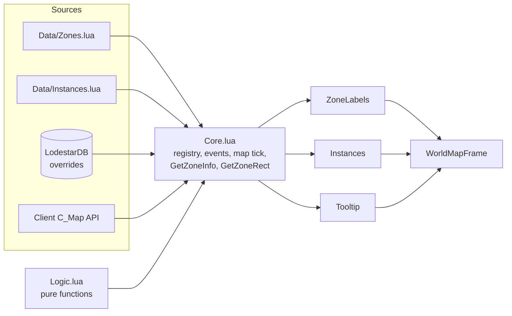

# Lodestar – WoW Forever Map Addon Design Doc

Oct 12, 2026 · @Ludovico · Status: Draft

## Overview and goals

Lodestar is a World of Warcraft: Forever addon that puts level, faction and instance information on the world map. The name (working title MapLevels until Oct 12, 2026) refers to a guiding star: it points to where to go at the player's level. It is inspired by the zone-level display of the old Cartographer addon; matching Cartographer's full feature set is not a requirement.

**Goals**

- Show each zone's level range on the map, colored by how it compares to the player's level.
- Mark dungeon and raid entrances with their level ranges.
- Stay data-driven: zones added by Forever's expansions are added by editing a table, not code.

**Non-goals (MVP)**

- No quest-giver, vendor or resource-node database.
- No replacement of Blizzard's map frame; the addon only draws on top of it.
- No minimap changes.
- No coordinate display: Forever's map already shows cursor and player coordinates at its bottom left (seen during P3, Oct 12, 2026).
- Forever only: no support for Classic Era, Cataclysm Classic or Retail. The `.toc` lists only Forever's interface number.
- No integration or compatibility work with other map addons (Questie, HandyNotes and similar); Lodestar runs as the only addon.
- No localization: the client is English, so instance names, faction names and all addon text are English only.

**Success criteria**

1. **Loads cleanly.** With `/console scriptErrors 1`, no Lua errors at login, at `/reload`, when opening the map, or when switching between world, continent and zone maps. Checked on the beta and again on the live client.
2. **Zone labels.** Every zone row in `Zones.lua` shows a label on its continent map, with both ends colored correctly for the player's current level; `/ls dump` reports no zone row without a label.
3. **Instance markers.** Every entry in `Instances.lua` shows a marker on its zone map and on its continent map; hovering one shows name, kind and level range.
4. **Zone tooltip.** Hovering a zone on a continent map shows its name, range, faction and instances, and the tooltip hides when the cursor leaves the zone.
5. **Idle cost.** With the map closed, the addon has no `OnUpdate` handler running; `/ls debug` reports whether the map tick is active, so this can be checked in game.
6. **Survives.** `/reload`, a level-up (labels recolor), opening the map in combat (no errors, and no taint per P15), and `/ls toggle` of each module (off and back on without `/reload`, with overlays disappearing and reappearing immediately).

## Target client and API assumptions

Forever is a permanent Classic variant with a level cap of 60, launching on November 4, 2026; the beta runs from September 17 to October 21 ([Zockify](https://www.zockify.com/forever/), [Warcraft Wiki](https://warcraft.wiki.gg/wiki/Forever)). Its addon API is not documented yet, so everything below is an assumption to verify in game before writing code.

Lodestar is for personal use: the source is public on GitHub under the MIT license, but no release on addon sites is planned. The beta is the first place to probe and test, but the live client is just as valid after the beta closes, so there is no hard deadline; the beta days are simply used to learn as much as possible early.

| # | Assumption | Why it matters | Probe in game |
| --- | --- | --- | --- |
| A1 | The client uses a Classic-era addon environment (Lua 5.1, `.toc` file, SavedVariables) | Sets the `.toc` interface number and the allowed Lua features | `/dump (select(4, GetBuildInfo()))` |
| A2 | `C_Map` exists (`GetMapInfo`, `GetMapChildrenInfo`, `GetBestMapForUnit`, `GetPlayerMapPosition`) | The whole data model is keyed by uiMapID | `/dump C_Map and C_Map.GetBestMapForUnit("player")` |
| A3 | `WorldMapFrame` is a map canvas that accepts addon data providers and pins (`AddDataProvider`, `AcquirePin`), as in Classic Era | Decides how overlays are drawn: pins scale with zoom and are pooled and refreshed by Blizzard's map. Without it, the fallback is plain frames on the canvas | `/dump WorldMapFrame.AddDataProvider, WorldMapFrame.AcquirePin, WorldMapFrame.ScrollContainer` |
| A4 | Continent maps list their child zones, and each zone's rectangle on the continent can be queried | Gives label positions without hand-tuned coordinates. `GetMapChildrenInfo` returns only IDs, names and types, not positions; the rectangle comes from `GetMapRectOnMap` | `/dump C_Map.GetMapChildrenInfo(1415, 3)`, then `/dump C_Map.GetMapRectOnMap(1429, 1415)` (Elwynn Forest on Eastern Kingdoms) |
| A5 | The new zones (Mount Hyjal, Riverglades, Shen'dralas, Zephras Isle) have uiMapIDs | They need rows in the zone table | P5 lists the continents' children; P10: `/ls dump` on each continent map and on the Zephras Isle map |
| A6 | Blizzard's map does not already show zone levels | Avoids duplicating a native feature | Open the map and look |
| A7 | The client may know zone level ranges through `C_Map.GetMapLevels(uiMapID)` (returns player min and max level, then pet levels) | If present, level ranges come from the game and `Zones.lua` no longer has to be filled by hand | `/dump C_Map.GetMapLevels ~= nil`, then `/dump C_Map.GetMapLevels(1429)` |
| A8 | The zone under the cursor can be found from the cursor position (`ScrollContainer:GetNormalizedCursorPosition`, `C_Map.GetMapInfoAtPosition`) | The zone tooltip needs to know which zone is hovered; Classic Era maps show only a one-line name label on hover, not a tooltip the addon could extend | Hover a zone on a continent map and run `/dump C_Map.GetMapInfoAtPosition(WorldMapFrame:GetMapID(), WorldMapFrame.ScrollContainer:GetNormalizedCursorPosition())` (bind it to a macro so the cursor stays on the map) |

A failed probe changes the design, not just a line of code, so run the design probes (P1-P9) in the "Beta verification checklist" section before writing code.

## Feature set

The MVP is three map overlays that read from one data table; v2 adds user-generated and exploration features.

| Feature | Tier | Behavior | Needs |
| --- | --- | --- | --- |
| Zone level labels | MVP | Text on each zone of the continent maps (not the world map showing both continents): `min-max`, colored by difficulty against the player's level; faction tag for Alliance, Horde or contested | Zone table, child-zone rectangles (`GetMapRectOnMap`) |
| Instance markers | MVP | Icon on each dungeon or raid entrance with name and level range; tooltip on hover | Instance table |
| Zone tooltip | MVP | Hover over a zone: level range, faction control, instances inside it | Zone and instance tables |
| Waypoints and notes | v2 | Right-click to drop a pin; `/way x y` command; saved per account | SavedVariables |
| Unexplored areas | v2 | Tint sub-areas the character has not discovered yet | Exploration API (probe first) |
| Map look and feel | v2 | Opacity, scale and movable window | Frame hooks |
| Zones off the continents | v2 | Show the level range on the zone's own map for zones no continent shows (Zephras Isle on the beta), if the live client still leaves them off the world map | Zone table |
| Best zone for your level | v2 | Highlight zones where the player's level falls inside the range | Zone table |

**Difficulty colors** follow the game's own convention: grey for trivial, green for easy, yellow for even, orange for challenging, red for too high.

- **Each end is colored on its own.** In a `min-max` label, `min` gets the color of its level and `max` gets the color of its level; the dash stays neutral (white). At level 21, Redridge `15-25` shows a green `15` and an orange `25`: the zone is open now, and its top end is still worth coming back for. A single-level zone shows one colored number. Instance markers and tooltips use the same rule.
- **Client first.** Use the client's `GetQuestDifficultyColor(level)` when it exists, so the addon matches quest colors in the rest of the UI.
- **Fallback in `Logic.lua`**, used when the client function is missing and unit tested outside the game. It mirrors Blizzard's Classic quest-color logic, with `diff = level - playerLevel`:

| Condition | Color |
| --- | --- |
| `diff >= 5` | red |
| `diff >= 3` | orange |
| `diff >= -2` | yellow |
| `-diff <= greenRange` | green |
| otherwise | grey |

`greenRange` comes from the client's `GetQuestGreenRange()` when it exists. Otherwise it is derived from the Classic grey-level formula (`playerLevel <= 5`: nothing is grey; `6-39`: grey at or below `playerLevel - floor(playerLevel / 10) - 5`; `40` and up: grey at or below `playerLevel - floor(playerLevel / 5) - 1`), marked unverified until checked against the client at a few levels.

## Architecture

The addon is a small core plus independent modules, all sharing one namespace table. Think of the core as a game's service locator: modules register themselves, the core starts them, and no module calls another directly.



Modules draw on the map frame and talk only to the core, which merges the shipped data, the client's answers and the user's saved overrides.

```text
Lodestar/             # repo root, linked into Interface/AddOns as Lodestar
  Lodestar.toc        # metadata, load order, SavedVariables name
  Logic.lua            # pure functions, no WoW API calls: colors, lookup merge, projection, formatting
  Util.lua             # WoW-side helpers: safe-call wrapper, chat printing, color codes from Logic results
  Core.lua             # namespace, event dispatcher, module registry, DB init, map tick, zone rectangle cache
  Data/
    Zones.lua          # uiMapID -> level range, faction, type
    Instances.lua      # entrances: zone uiMapID, x, y on that zone's map, level range
  Modules/
    ZoneLabels.lua
    Instances.lua
    Tooltip.lua
    Waypoints.lua      # v2
  Pins.xml             # virtual pin templates (MapCanvasPinTemplate) used by the map overlays
  Debug.lua            # /ls probe, /ls dump, the SavedVariables log and the copy window
  Options.lua          # slash commands, later a settings panel
  tests/               # run.lua harness and *_spec.lua unit tests for Logic.lua, run outside the game; not listed in the .toc
  scripts/check.ps1    # runs luacheck, then the tests; the one check command
  tools/               # downloaded lua5.1.exe and luacheck.exe; git-ignored
  .luacheckrc          # luacheck config: Lua 5.1, WoW globals, allowed Lodestar globals
  .gitignore           # ignores tools/
  LICENSE              # MIT
  notes/               # probe output (beta-probes.md), error logs, /ls dump output
  docs/                # this design doc
```

**Load order** in the `.toc`: `Logic.lua`, `Util.lua`, `Core.lua`, `Data\Zones.lua`, `Data\Instances.lua`, the `Modules\*.lua` files, `Pins.xml`, `Debug.lua`, `Options.lua`. `Logic.lua` comes first because everything else uses it; `Pins.xml` comes after the modules because its templates name the pin mixins the modules define. The game loads only the files listed in the `.toc`, so `tests/`, `scripts/`, `tools/`, `notes/` and `docs/` living in the addon folder is harmless.

`Pins.xml` exists because Blizzard's map creates pins from named XML templates; it holds templates only, with all behavior in the Lua modules. An XML template can only find its mixin by global name, so each pin mixin is a global named `Lodestar...PinMixin`.

**Rules**

- **One namespace.** Every file starts with `local addonName, ns = ...`; nothing is global except the SavedVariables table, slash command handlers, and names that Blizzard's templates require to be global: the `LodestarTooltip` frame, the `LodestarCopyFrame` frame (a global name lets Escape close it through `UISpecialFrames`), and the `Lodestar...PinMixin` tables used by `Pins.xml`. Every such global starts with `Lodestar` and is listed in `.luacheckrc`. Globals in Lua are like unscoped statics in C++: they leak into every other addon.
- **Module contract.** A module is a table with `OnEnable()` and `OnDisable()`, registered with `ns:RegisterModule(name, module)`. The core calls `OnEnable` on `PLAYER_LOGIN` for every module the user has not disabled.
- **One event frame.** The core owns a single frame and dispatches events to subscribers; modules call `ns:RegisterEvent(name, handler)` instead of creating their own frames.
- **Overlays are map data providers.** Map overlays register with `WorldMapFrame:AddDataProvider` in `OnEnable` and unregister with `RemoveDataProvider` in `OnDisable`. Blizzard's map calls the provider only while the map is shown (on open and on every map change), so nothing runs while the map is closed. If `WorldMapFrame` does not exist yet at `PLAYER_LOGIN`, the core waits for `ADDON_LOADED` of `Blizzard_WorldMap` before enabling map modules.
- **Map tick.** The core owns one throttled `OnUpdate` handler that runs every 0.1 s, and only while `WorldMapFrame` is shown: it is set in the map's `OnShow` hook and cleared in `OnHide`. Modules that need to follow the cursor or the player subscribe with `ns:RegisterMapTick(handler)` instead of creating their own `OnUpdate` handlers. Tooltip uses it.
- **No libraries in the MVP.** Plain Lua 5.1, no Ace3. Revisit when the options panel is built.
- **No taint.** "Taint" is what happens when addon code touches Blizzard's UI in a way that later makes protected actions fail ("Interface action failed because of an AddOn"), usually in combat. So:
  - Never replace or reassign a Blizzard function, or a field on a Blizzard frame or mixin.
  - To react to Blizzard code, use `hooksecurefunc` (runs after a Blizzard function) or `frame:HookScript` (runs after a Blizzard script handler).
  - Call `SetScript` only on frames Lodestar created itself, never on Blizzard frames.
  - Data providers and pins added through `AddDataProvider` and `AcquirePin` are the supported way to draw on the map and count as allowed.
- **Safe calls.** Module entry points are wrapped so one module's error is reported and does not stop the others.

## Data model

All static game knowledge lives in plain Lua tables keyed by uiMapID, and user changes live in a separate override layer. Keying by uiMapID instead of zone name keeps the addon locale-proof; zone names are read at runtime from the client.

**Where the data comes from.** Both tables start from public Classic Era data (Warcraft Wiki zone pages and the Classic Era uiMapID list): zone IDs, factions, level ranges and dungeon entrance coordinates. Most of Forever's 1-60 world is expected to match vanilla, so the game is used to check that data and add what is new or changed, not to collect everything from scratch. Each row carries a trailing comment saying where it came from:

- `-- vanilla, unverified`: seeded from public data, not yet checked in game.
- `-- verified YYYY-MM-DD`: checked in game on that date (position, level range or both).
- `-- forever, YYYY-MM-DD`: new in Forever, recorded in game on that date.

**Zones** (`Data/Zones.lua`). The values below are examples only. `min` and `max` are optional when the client provides levels (see the lookup rule); `faction` and `kind` are always needed, because the client does not provide them.

```lua
local _, ns = ...
ns.Zones = {
  -- [uiMapID] = { [min, max,] faction, kind [, labelX, labelY] }
  [1429] = { min = 1,  max = 10, faction = "Alliance", kind = "zone" },  -- example
  [1411] = { min = 1,  max = 10, faction = "Horde",    kind = "zone" },  -- example
}
```

`labelX` and `labelY` are optional, in the parent continent's normalized coordinates. Set them only where the rectangle center lands badly (for example an L-shaped zone, or a zone whose center sits in water); otherwise the label goes at the center of the zone's rectangle.

**Instances** (`Data/Instances.lua`).

```lua
ns.Instances = {
  -- { name, map = zone uiMapID, x, y (0-1 on that zone's map), min, max, kind = "dungeon" | "raid" }
  { name = "Hall of Thanes", map = 0, x = 0.0, y = 0.0, min = 13, max = 18, kind = "dungeon" },  -- forever, fill in game
}
```

- `map` is always the uiMapID of the **zone** that contains the entrance (map type 3), never a continent.
- `x` and `y` are normalized 0-1 positions on that zone's map: exactly what `C_Map.GetPlayerMapPosition` reports while standing at the entrance.
- If the game reports a smaller map at the entrance (a cave, or a sub-map such as Blackrock Mountain), record the position on the parent zone instead: open the zone's map and read the cursor position over the entrance, or walk to the cave mouth while the zone map still applies.
- Positions on other maps (continents) are never stored; they are projected at runtime (see "Map positions" below).
- There is no in-game override for instances: since the addon is for personal use, a wrong entrance is fixed by editing `Instances.lua` directly.

**Map positions.** The core keeps one cache of zone rectangles, `ns:GetZoneRect(zoneID, mapID)`, which wraps `C_Map.GetMapRectOnMap` and returns `nil` when the zone does not appear on that map. The game does not return `nil` in that case but a rectangle of four zeros (P5, Zephras Isle on the world map), so any rectangle with `maxX <= minX` or `maxY <= minY` counts as "not on this map"; that check is a pure function in `Logic.lua` with a unit test. Both ZoneLabels and Instances use it. A point `(x, y)` on a zone's map is projected onto a parent map with:

```lua
-- Logic.lua: pure function, unit tested
function Logic.ProjectToParent(minX, maxX, minY, maxY, x, y)
  return minX + x * (maxX - minX), minY + y * (maxY - minY)
end
```

**SavedVariables** (`LodestarDB`, declared in the `.toc`).

```lua
LodestarDB = {
  version = 1,                       -- bump on schema change, migrate in Core.lua
  modules = { ZoneLabels = true, Instances = true, Tooltip = true },
  overrides = { zones = {} },        -- [uiMapID] = { min, max }; set in game with /ls zone, win over client and shipped data
  waypoints = {},                    -- [uiMapID] = { { x, y, note }, ... }  (v2)
  log = {},                          -- { { time, command, lines = { ... } }, ... }; last 50 entries, see "Getting output out of the game"
}
```

**Lookup rule.** `ns:GetZoneInfo(mapID)` builds the zone's info field by field, so each field comes from the best source that has it:

| Field | 1st source | 2nd source | 3rd source |
| --- | --- | --- | --- |
| `min`, `max` | User override | `C_Map.GetMapLevels(mapID)`, if the function exists and returns a minimum above 0 (on the beta it exists but returns four zeros for every zone, P6) | `Zones.lua` |
| `faction`, `kind`, `labelX`, `labelY` | User override | `Zones.lua` | none |

The result also records where the level range came from (`"override"`, `"client"` or `"table"`), so `/ls dump` and debug output can show it. A zone with no level range from any source shows no label, so missing data never raises an error. The merge itself lives in `Logic.lua` and takes the client's answer as a plain argument, so it can be unit tested without the game.

**Localization.** Zone names come from `C_Map.GetMapInfo`. Instance names are stored in English, which matches the English client; no locale table is planned (see Non-goals).

## Module specs

Each module is independent, can be disabled, and reads only from the data layer and the map frame.

**How map overlays draw.** ZoneLabels, Instances and Waypoints each follow the same pattern, which is how Blizzard's own map icons work:

- A data provider: a table made with `CreateFromMixins(MapCanvasDataProviderMixin)` that implements `RefreshAllData()` and `RemoveAllData()`. Blizzard calls `RefreshAllData` when the map opens and when it changes to another map.
- A pin template in `Pins.xml` that inherits `MapCanvasPinTemplate`, with a Lua mixin based on `MapCanvasPinMixin`. `RefreshAllData` first calls `map:RemoveAllPinsByTemplate(template)`, then `map:AcquirePin(template, data)` for each item. The pin places itself with `self:SetPosition(x, y)` in the current map's normalized coordinates.
- Scaling with zoom is set per template with `SetScalingLimits`, so text and icons stay readable when zoomed in instead of growing with the map.
- The map owns the pin pools, so objects are reused across refreshes and no module keeps its own pool.
- **Which maps get overlays.** `RefreshAllData` first removes its pins, then checks the current map's `mapType` from `C_Map.GetMapInfo`. ZoneLabels draws only on continent maps (`Enum.UIMapType.Continent`); Instances draws on continent and zone maps (`Continent` and `Zone`). On the world map (`World`), the cosmic map and anything else, the providers draw nothing, because about 45 labels on the small world map would overlap heavily.

| Map | ZoneLabels | Instances |
| --- | --- | --- |
| World (both continents) | none | none |
| Continent | one label per zone | projected markers |
| Zone | none | markers at stored positions |

Fallback if P3 fails (assumption A3): each module creates its own pool of frames parented to `WorldMapFrame.ScrollContainer.Child` and refreshes from a `hooksecurefunc(WorldMapFrame, "OnMapChanged", ...)` hook. The module specs below do not change; only this drawing layer does.

**ZoneLabels**

1. A data provider with one label pin template (a frame holding a `FontString`).
2. In `RefreshAllData`, if the current map is a continent, get its child zones with `C_Map.GetMapChildrenInfo(currentMapID, Enum.UIMapType.Zone)` and look up each in `ns:GetZoneInfo`.
3. Place each label at the zone's `labelX, labelY` if set, otherwise at the center of the zone's rectangle from `ns:GetZoneRect(zoneID, currentMapID)` (`(minX + maxX) / 2, (minY + maxY) / 2`). Set text to `min-max` with each end colored separately (see "Difficulty colors"), built as `|cffRRGGBBmin|r-|cffRRGGBBmax|r`.
4. On `PLAYER_LEVEL_UP`, call the provider's `RefreshAllData` if the map is shown; otherwise do nothing, because the next map open refreshes anyway.

**Zones off the continents.** On the beta, Zephras Isle (2521) is a zone whose parent is the world map (947), and it has no placement there: `GetMapRectOnMap(2521, 947)` returns four zeros and the world map does not draw it. So no continent map shows it, ZoneLabels never labels it, and the zone tooltip can never hover it. It still gets a row in `Zones.lua`, so `/ls dump` and lookups know its range. This is a known MVP gap, to re-check on the live client after Nov 4, 2026, where the island may get a place on the world map; a label on the island's own zone map is a v2 option.

Edge cases: a zone with no data shows no label; a zone with a single level shows `n`; if Blizzard draws permanent zone names on the continent map (note it during P9), offset labels below the name; otherwise center them. Test at both map sizes.

**Instances**

- A data provider with one icon pin template; the pin's `OnMouseEnter` shows a tooltip with name, kind and level range.
- In `RefreshAllData`, if the current map is a continent or a zone, then for each entry in `ns.Instances`:
  - If `entry.map` is the current map, place the pin at `entry.x, entry.y` as is.
  - Otherwise, if `ns:GetZoneRect(entry.map, currentMapID)` returns a rectangle, place the pin at `Logic.ProjectToParent(minX, maxX, minY, maxY, entry.x, entry.y)` using that rectangle.
  - Otherwise, skip the entry: its zone is not on this map.
- Entrances sharing a position are offset slightly so both stay clickable.

**Tooltip**

Classic Era maps do not show a tooltip when hovering a zone, only a one-line name label at the top of the map, so Lodestar shows its own tooltip instead of extending Blizzard's.

- **Where:** continent maps only. On zone maps the whole map is one zone, and instance pins already have their own tooltips.
- **Finding the hovered zone:** on each map tick (see "Map tick" in Architecture), read the cursor with `WorldMapFrame.ScrollContainer:GetNormalizedCursorPosition()` and ask `C_Map.GetMapInfoAtPosition(currentMapID, x, y)`. Only redraw the tooltip when the hovered zone changes, so the tooltip is not rebuilt ten times a second.
- **Tooltip frame:** its own frame, `LodestarTooltip`, made with `CreateFrame("GameTooltip", "LodestarTooltip", UIParent, "GameTooltipTemplate")` and anchored to the cursor. It is separate from `GameTooltip`, so it never fights Blizzard or other addons over the shared tooltip. Instance pins keep using `GameTooltip`; while an instance pin is hovered, `LodestarTooltip` hides.
- **Contents:**
  1. Zone name (from `C_Map.GetMapInfo`).
  2. `Levels min-max`, each end colored as in "Difficulty colors"; `No level data` in grey when no source has a range.
  3. Faction: Alliance (blue), Horde (red) or Contested (yellow).
  4. Instances in the zone (the entries of `ns.Instances` whose `map` equals the hovered zone's uiMapID), one line each with name, colored range and kind; the section is left out when there are none.
- **Hide** when the cursor leaves the map canvas, moves over a part of the continent with no zone, or the map closes.
- Uses the same `ns:GetZoneInfo` lookup as ZoneLabels, so there is no second source of truth.

**Waypoints (v2)**

- Right-click on the map drops a pin stored in `LodestarDB.waypoints`.
- `/way x y [note]` adds a pin on the current map; `/way clear` removes pins on it.
- Pins are drawn by a data provider, like the other overlays.

**Combat and taint.** The addon touches only the map frame and its own frames, never secure action buttons, and follows the "No taint" rule in Architecture, so combat lockdown should not affect it. Verify in game with P14 and P15.

## Settings and slash commands

The MVP has no settings window; everything is a slash command, which is fast to build and easy to test. The command is `/ls`, with `/lodestar` as a longer alias.

| Command | Effect |
| --- | --- |
| `/ls` | Print the command list |
| `/ls toggle <module>` | Enable or disable a module (`ZoneLabels`, `Instances`, `Tooltip`). Takes effect immediately: the core calls the module's `OnDisable` or `OnEnable`, which removes or adds its data provider and map tick subscription. The choice is saved in `LodestarDB.modules`; no `/reload` needed |
| `/ls zone <mapID\|here> <min> <max>` | Save a level-range override for a zone. `here` means the map currently shown on the world map frame (or the player's zone when the map is closed), so IDs do not have to be looked up |
| `/ls zone <mapID\|here> reset` | Remove that zone's override, so the client or table value applies again |
| `/ls overrides` | List every saved override with the client's and the table's value next to it, to spot overrides that are no longer needed |
| `/ls dump` | Print the current map's ID, name and child zones. For each zone, print the level range from `C_Map.GetMapLevels` and from `Zones.lua` side by side, flagging any mismatch or missing row. For each zone missing from `Zones.lua`, also print a ready-made Lua row, for example `[1440] = { min = 20, max = 30, faction = "", kind = "zone" },  -- forever, 2026-10-14`, with the range from the client when it has one and the faction left blank to fill in |
| `/ls debug` | Toggle verbose logging to the chat frame. When turned on, also prints which modules are enabled and whether the map tick is running |
| `/ls probe` | Run the design probes that can be run from code (P1-P6 and P8) and print a pass, fail or value line for each |
| `/ls probe hover` | P7: report the zone under the cursor. Meant to be bound to a key through a macro, so the cursor can stay on the map |
| `/ls copy` | Open the copy window with the output of the last `/ls` command |
| `/ls log clear` | Empty `LodestarDB.log` |
| `/way x y [note]` | Add a waypoint on the current map (v2) |

`/ls dump` is the most important command early on: it is how the seeded zone table gets checked against the game, and how new zones get added. A real options panel is a v2 task.

**Getting output out of the game.** WoW's chat window does not let you select or copy text, so every command that produces output for later use (`/ls probe`, `/ls dump`, `/ls overrides`, and errors caught by the safe-call wrapper) also sends it to two places:

1. **The log in SavedVariables.** Each output is appended to `LodestarDB.log` with a timestamp and the command that produced it, keeping the last 50 entries. The game writes SavedVariables to disk on `/reload` and on logout, to `WTF/Account/<ACCOUNT>/SavedVariables/Lodestar.lua` in the game folder, where Claude Code can read it directly. This is the route for big outputs: probes and dumps.
2. **The copy window.** `/ls copy` opens a small movable frame with a multi-line edit box holding the last output, already selected, so Ctrl+C copies it. Escape closes it. It is created on first use and is the quick route for one-off checks.

Two cautions. The game reads SavedVariables at login and overwrites the file at logout, so the file must never be edited while the game runs; Claude Code only reads it. And the probe code lives in its own file (`Debug.lua`) that depends on nothing but the namespace, so `/ls probe` works on the very first build, before any module exists.

## Beta verification checklist

Run these probes in the Forever beta while it is open (until Oct 21, 2026), or on the live client afterwards, and record the raw output in `notes/beta-probes.md` in the repo so the coding session can read it. Before the addon exists, run P1-P9 as the `/dump` commands below and take screenshots, which Claude Code can read; from M2 on, `/ls probe` runs the same checks and writes them to the SavedVariables log (see "Getting output out of the game"), and Claude Code copies them into `notes/beta-probes.md`. Most items need no travel: they run from the world map or from wherever the character stands.

**Setup:** turn on Lua errors with `/console scriptErrors 1` before anything else.

Probes are numbered `P1`, `P2` and so on; the "Checks" column links each one to the assumption (`A1`-`A8`) in "Target client and API assumptions" that it verifies.

**Design probes.** Run these first; they need no addon and no travel, and a failure changes the design.

| # | Checks | Probe |
| --- | --- | --- |
| P1 | A1 | Record the interface number: `/dump (select(4, GetBuildInfo()))`, and use it in the `.toc` |
| P2 | A2 | Confirm `C_Map` exists: `/dump C_Map ~= nil`, then `/dump C_Map.GetMapInfo(C_Map.GetBestMapForUnit("player"))` and `/dump Enum.UIMapType` (map type numbers used to tell world, continent and zone maps apart) |
| P3 | A3 | Check the map canvas: `/dump WorldMapFrame.AddDataProvider, WorldMapFrame.AcquirePin, MapCanvasPinMixin ~= nil`; all three should be non-nil. Then open the map, run `/fstack`, and note the frame names under `WorldMapFrame` |
| P4 | A3 | Check whether the map is loaded at login: right after `/reload`, before opening the map, run `/dump WorldMapFrame ~= nil` |
| P5 | A4 | On each continent map, run `/dump C_Map.GetMapChildrenInfo(<continentID>, 3)` to list its zones, then `/dump C_Map.GetMapRectOnMap(<zoneID>, <continentID>)` for one zone, and check that the four numbers fall between 0 and 1 and match where the zone sits on the map |
| P6 | A7 | Check for client level data: `/dump C_Map.GetMapLevels ~= nil`, then `/dump C_Map.GetMapLevels(1429)` (not `f and f(...)`, which keeps only the first return value). Four zeros mean no data. If it returns ranges, compare a few zones against what the game shows elsewhere (quest levels, mob levels) before trusting it |
| P7 | A8 | Check zone hover: make a macro `/dump C_Map.GetMapInfoAtPosition(WorldMapFrame:GetMapID(), WorldMapFrame.ScrollContainer:GetNormalizedCursorPosition())`, bind it to a key, open a continent map, hover a zone and press the key; it should print that zone's info. Also note what Blizzard shows on hover (name label, tooltip, or nothing) |
| P8 | none (colors) | Check the difficulty-color functions: `/dump GetQuestDifficultyColor ~= nil, GetQuestGreenRange ~= nil`, then `/dump GetQuestGreenRange()` if it exists, then `/dump GetQuestDifficultyColor(UnitLevel("player") + 3)` (expect orange) |
| P9 | A6 | Check whether Blizzard's map already shows zone levels |

**Data probes.** These need the M2 skeleton (`/ls dump`) loaded; they check and fill the seeded tables.

| # | Checks | Probe |
| --- | --- | --- |
| P10 | A5 | Compare zone IDs against the seeded table: run `/ls dump` on each continent map (no travel needed). Note zones missing from the table, including the new ones (Mount Hyjal, Riverglades, Shen'dralas), and IDs that differ from vanilla. Zephras Isle is not on a continent: run `/ls dump` while standing on the island, where the map opens on it |
| P11 | data | Record level ranges only where they differ from the seeded table, or where `GetMapLevels` is missing; expanded zones may differ from vanilla |
| P12 | data | Record entrance positions for new dungeons and raids (Hall of Thanes and any others) by standing at the entrance and running `/dump C_Map.GetBestMapForUnit("player"), C_Map.GetPlayerMapPosition(C_Map.GetBestMapForUnit("player"), "player"):GetXY()`. If the map ID is not the zone (check with `/dump C_Map.GetMapInfo(<id>).mapType`, which should be 3), use the zone map's cursor position instead. Spot-check two or three vanilla entrances against the seeded coordinates, and travel to others only if those disagree |

**Other probes.** These check v2 options and behavior in combat. P14 and P15 only mean something once the overlays exist (M4), and are repeated at M5.

| # | Checks | Probe |
| --- | --- | --- |
| P13 | v2 | Check for an exploration API: `/dump C_MapExplorationInfo` |
| P14 | taint | Open the map in combat and confirm no errors appear |
| P15 | taint | Run `/console taintLog 1` and `/reload`. With Lodestar enabled, open and close the map in combat, then use an action bar ability while still in combat. Confirm chat shows no "Interface action failed because of an AddOn" message, and that `Logs/taint.log` (in the game folder, written on logout or `/reload`) has no lines blaming Lodestar. Turn logging off afterwards with `/console taintLog 0` |

**API probes.** These need no addon and should run before M2, while the beta is open; they confirm the globals and widget features the code will use (evidence rule). The exact commands are in `notes/beta-probes.md`.

| # | Checks | Probe |
| --- | --- | --- |
| P16 | M2 APIs | `CreateFrame`, `hooksecurefunc`, `UIParent`, `DEFAULT_CHAT_FRAME`, `UISpecialFrames`, `SlashCmdList`, `time`, `date`, `GetTime`; an event frame with `RegisterEvent` and `SetScript`; `HookScript` on the map's `OnShow`/`OnHide` and `hooksecurefunc` on `OnMapChanged`; a colored chat line; a test slash command (and that `/ls` and `/lodestar` are free); the copy window pieces (multi-line `EditBox`, `UIPanelScrollFrameTemplate`, `BasicFrameTemplateWithInset`, `BackdropTemplate`) |
| P17 | M4-M5 APIs | `CreateFromMixins`, `Mixin`, `MapCanvasDataProviderMixin`, `WorldMapFrame.RemoveDataProvider` and `RemoveAllPinsByTemplate`, `GameTooltip`, the pin methods `SetPosition` and `SetScalingLimits`, `C_Map.GetPlayerMapPosition`, and a tooltip made from `GameTooltipTemplate` |

Copy the tables into `notes/beta-probes.md` and tick each probe there as it is done, next to its raw output.

## Development workflow

Claude Code with the Zed editor is a good fit: an addon is plain text with no build step, so the loop is short. The one limit is that Claude Code cannot run the game, so you are the test harness. The workflow below is designed around that.

**Dev environment setup (milestone M1)**

Everything here is Windows, needs no installer, and keeps the tools out of git.

1. **Repo.** Clone the GitHub repo (created with the MIT `LICENSE`) or `git init` and add it as the remote, with a `.gitignore` containing `tools/`.
2. **Game link.** Create a junction so the game loads the addon straight from the repo: in PowerShell, `New-Item -ItemType Junction -Path "<WoW folder>\<Forever folder>\Interface\AddOns\Lodestar" -Target "D:\DEV\wow-lodestar"`. The junction must be named `Lodestar`, matching the `.toc` name. Record the exact game folder path in `notes/environment.md`, because the SavedVariables path depends on it too.
3. **Lua 5.1.** Download the Windows 64-bit binaries of Lua 5.1.5 from LuaBinaries and unzip them to `tools/lua/`. This is the same Lua version the game runs, so anything that works in the tests behaves the same in game.
4. **luacheck.** Download the standalone `luacheck.exe` from the luacheck GitHub releases into `tools/`. No LuaRocks needed.
5. **`.luacheckrc`.** In the repo root:

   ```lua
   std = "lua51"
   max_line_length = false
   exclude_files = { "tools/**" }
   -- Globals Lodestar writes (see the "One namespace" rule)
   globals = {
     "LodestarDB", "SLASH_LODESTAR1", "SLASH_LODESTAR2", "SlashCmdList",
     "LodestarTooltip", "LodestarCopyFrame",
     -- one line per pin mixin, e.g. "LodestarZoneLabelPinMixin",
   }
   -- WoW API the addon reads. Only APIs confirmed in notes/beta-probes.md (evidence rule);
   -- add each one here when a probe confirms it.
   read_globals = {
     "GetBuildInfo", "C_Map", "Enum", "WorldMapFrame", "MapCanvasPinMixin",
     "GetQuestDifficultyColor", "UnitLevel",
   }
   files["tests/**"] = { globals = { "describe", "it" } }  -- harness helpers
   ```

   This is the starting list from P1-P9. The API probes P16 (M2: frames, events, hooks, chat, slash commands, copy window) and P17 (M4-M5: mixins, data provider, pins, tooltip) confirmed the rest on 2026-10-13, and those names were added to `.luacheckrc` then. Any API not in the file is unconfirmed, and luacheck flags its use. `GetQuestGreenRange` stays out: P8 found it missing.

6. **Test runner.** `tests/run.lua` is a small harness (about 30 lines) with `describe(name, fn)`, `it(name, fn)` and `assert`-based checks. It loads `Logic.lua` the way the game does, with `assert(loadfile("Logic.lua"))("Lodestar", ns)`, then runs every `tests/*_spec.lua` file and prints passes, failures and a final count, exiting with code 1 on any failure. The spec files use `describe` and `it`, so they could move to `busted` later with almost no changes.
7. **One check command.** `scripts/check.ps1` (kept in git) runs `tools/luacheck.exe .`, then `tools/lua/lua5.1.exe tests/run.lua`, and stops on the first failure. This is the single command Claude Code runs after every change. Only the downloaded binaries live in the ignored `tools/` folder.
8. **Editor help (Zed).** Install Zed's Lua extension (it runs lua-language-server) and clone Ketho's WoW API annotations, pinned to a tag, into `tools/wow-api`. The language server settings live in `.luarc.json` (Lua 5.1, the annotations folder), indentation in `.editorconfig`, and the check task and Lua tab size in `.zed/`, the only Zed-specific folder. Step-by-step setup: `notes/zed-setup.md`. This gives autocomplete, hover docs and typo warnings for the WoW API. The annotations describe Retail and Classic, not Forever, so a function that autocompletes is still only a candidate: the evidence rule below still decides what can be used, and differences found by probes are noted in `notes/beta-probes.md`.

M1 is done when `scripts/check.ps1` passes on a starter `Logic.lua` with one sample test, a deliberate global in a scratch file makes luacheck fail, the junction shows the repo's files inside the game's `AddOns` folder, and the editor shows WoW API completions in a `.lua` file. (M1 was first done with VS Code; the editor setup moved to Zed on 2026-10-14.)

**The loop**

1. Claude Code edits files and runs `scripts/check.ps1`; thanks to the junction from M1, the game already sees the edits.
2. You run `/reload` in game.
3. Run `/reload` once more after any `/ls` command whose output matters, so the SavedVariables log is written to disk; then tell Claude Code to read it from `WTF/Account/<ACCOUNT>/SavedVariables/Lodestar.lua`. For a quick check, use `/ls copy` and paste instead. For a Lua error outside the safe-call wrapper, a screenshot of the error popup works.
4. Commit when a milestone works.

**Keep the game out of the critical path**

- **Pure-logic file.** Put game-independent code (difficulty color, data lookup, override merge, zone-to-parent projection, coordinate formatting) in `Logic.lua` with no WoW calls. It is unit tested outside the game with `tests/run.lua` and a standalone Lua 5.1.
- **Static analysis.** Run `luacheck` with a WoW globals config; it catches accidental globals and typos, which are the most common Lua bug for C++ developers.
- **Evidence rule.** Claude Code must not guess an API. If a function is not confirmed in `notes/beta-probes.md`, it asks you to probe it first.
- **API reference.** Use the community mirror of Blizzard's UI source for the nearest Classic branch; Forever's own branch may not exist yet, so the in-game probes are the authority.

**Lua for C++ developers**

| C++ habit | Lua reality |
| --- | --- |
| Variables are local by default | Variables are global unless declared `local`; always write `local` |
| `nullptr` | `nil`; only `nil` and `false` are falsy, and `0` is truthy |
| Arrays start at 0 | Tables start at 1; `#t` is the length |
| `!=` | `~=` |
| Classes | Tables, optionally with metatables; modules here are plain tables |
| `namespace` | One table passed to every file via `local addonName, ns = ...` |
| Compile errors | None; mistakes show up at runtime, hence luacheck |

**Suggested `CLAUDE.md` rules**

```markdown
- Lua 5.1 only. Always declare variables `local`. No new globals.
- One shared namespace: `local addonName, ns = ...`.
- Game-independent logic goes in Logic.lua with no WoW API calls.
- Use only APIs listed in notes/beta-probes.md; otherwise ask me to probe.
- Read in-game output from WTF/Account/<ACCOUNT>/SavedVariables/Lodestar.lua; never edit that file.
- Map overlays are data providers with pins from Pins.xml; never create frames or FontStrings inside OnUpdate or per map refresh.
- Never replace or reassign Blizzard functions or fields; use hooksecurefunc or HookScript. SetScript only on our own frames.
- No libraries (Ace3 etc.) without asking.
- After every change run scripts/check.ps1 (luacheck + tests); fix failures before reporting done.
- When an API is confirmed or used, add it to read_globals in .luacheckrc.
```

## Milestones, risks and open questions

There is no hard deadline. The aim is to use the beta (until Oct 21, 2026) for as many probes and tests as possible, and to have the MVP running for launch on Nov 4, 2026 if it fits; anything left over continues on the live client.

**Milestones**

1. **M0, probes:** the design probes P1-P9 are done and their output (screenshots or transcribed values) is saved in `notes/beta-probes.md`. In parallel, outside the game, seed `Zones.lua` and `Instances.lua` from public Classic Era data, every row marked `-- vanilla, unverified`.
2. **M1, dev environment:** git repo, game junction, Lua 5.1, luacheck, `.luacheckrc`, the test runner, `scripts/check.ps1` and the editor setup are done, as described in "Dev environment setup". Can run in parallel with M0.
3. **M2, skeleton:** `.toc`, core, module registry, `Debug.lua` (`/ls probe`, `/ls dump`, the log and `/ls copy`) run in game with no errors, and Claude Code can read the log from the SavedVariables file.
4. **M3, data:** `/ls dump` output is used to check the seeded tables, add the new zones and dungeons, and fix any differences; checked rows are re-marked as verified.
5. **M4, overlays:** ZoneLabels works on the continent maps.
6. **M5, MVP complete:** Instances and Tooltip work, and all six success criteria in the Overview pass.
7. **M6, v2:** waypoints, unexplored areas and map look and feel, in the order the API allows.

**Risks**

| Risk | Impact | Mitigation |
| --- | --- | --- |
| Beta ends before all probes and data checks are done | Some rows stay unverified a little longer | Low impact: the tables start from vanilla data, and the remaining checks continue on the live client |
| API differs from the assumptions | Overlay approach needs rework | Design probes P1-P9 first; if `GetMapRectOnMap` is missing, fill `labelX, labelY` by hand for every zone (read off the map's native cursor coordinates while hovering each zone's center) |
| Beta data changes before launch or in later phases | Wrong level ranges | Prefer `C_Map.GetMapLevels` when it exists, so the client stays the source of truth; data-driven tables and user overrides otherwise; re-verify at launch |
| Blizzard ships zone levels natively | Duplicated feature | P9; keep the instance and coordinate features, which are separate |
| Overlay clutter on small maps | Labels overlap zone names or each other | No overlays on the world map; offset below Blizzard's names if it draws them; `labelX, labelY` for problem zones; per-module toggles |

**Open questions**

- [x] Which client language do you play in? **English**, so no locale table is needed (see Non-goals).
- [x] Is this for personal use, or will you publish it on a site such as CurseForge? **Personal use; no release on addon sites.** The source is public on GitHub under the **MIT license** (`LICENSE` in the repo root). Seed data taken from Warcraft Wiki is limited to facts (IDs, level ranges, coordinates); no wiki text and no Blizzard UI source is copied into the repo.
- [ ] Should v2 start with waypoints or unexplored-area highlighting?
